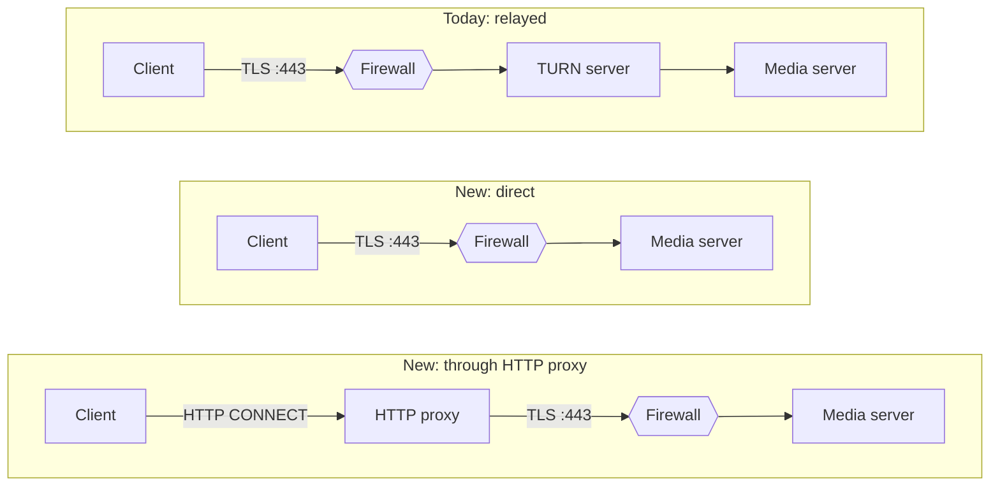
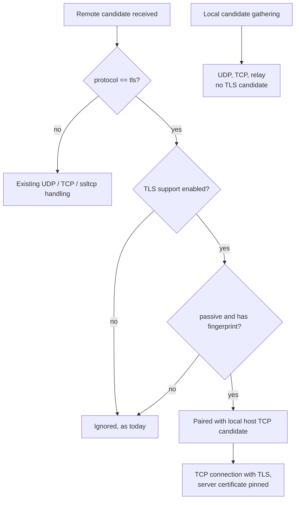
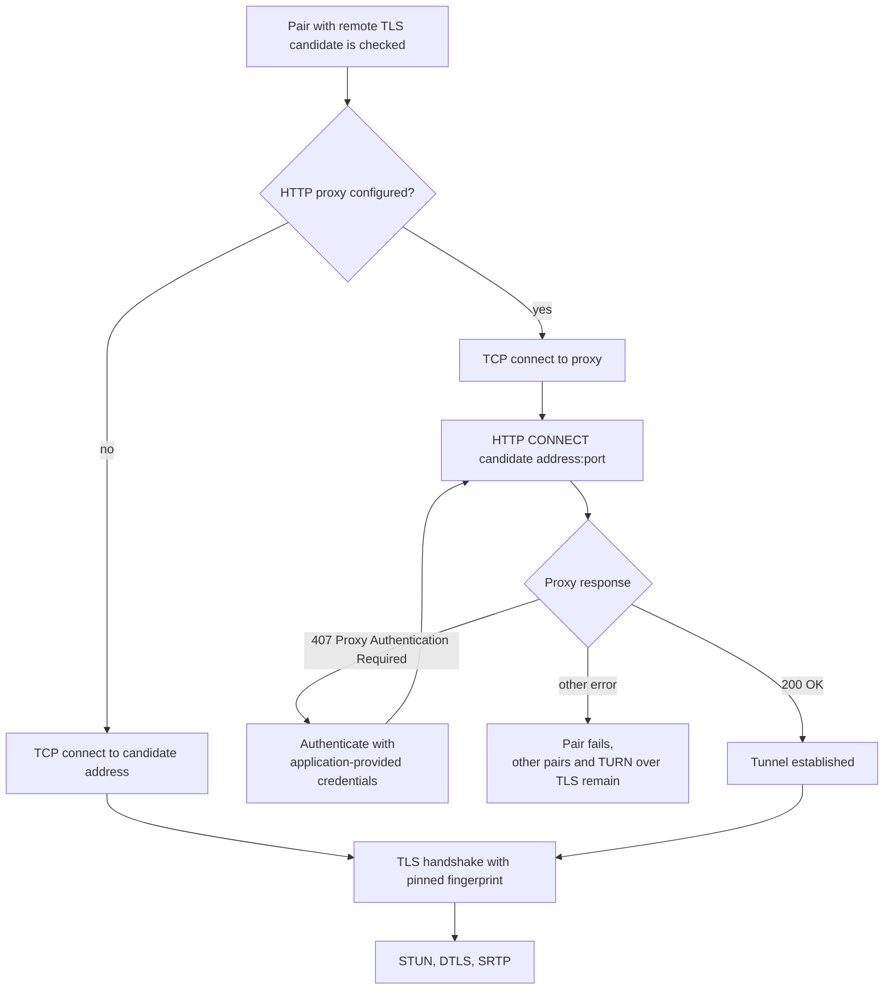
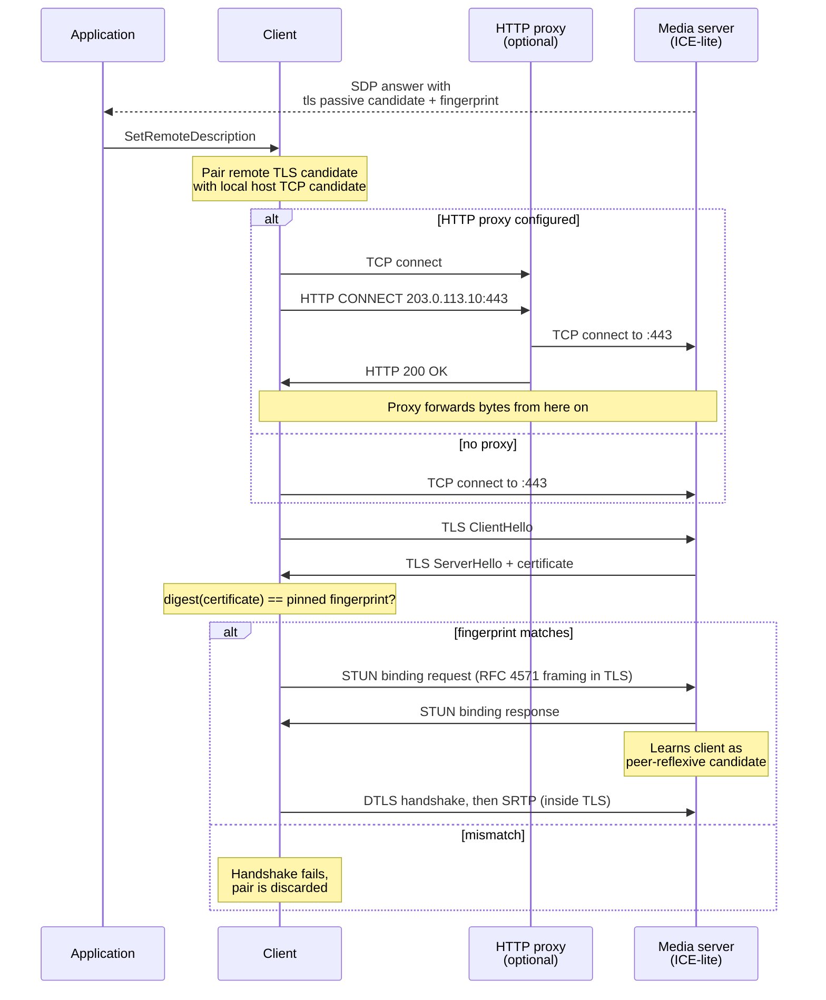
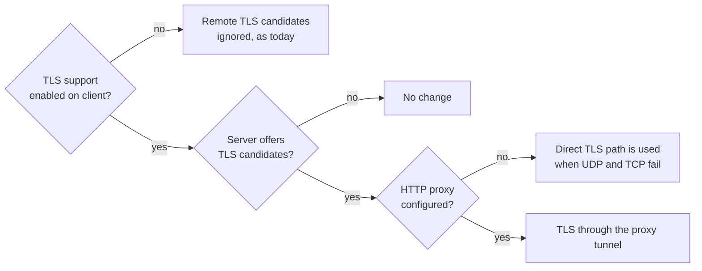

# ICE over TLS to Remote TLS Candidates: Design

## Summary

Some enterprise networks only let TLS on port 443 out. Today, the only way
for a WebRTC client in such a network to reach a media server is TURN over
TLS, even when the server is publicly reachable.

This design lets the client connect directly to a media server over TLS when
the server advertises a passive TLS ICE candidate with its certificate
fingerprint, as described in
[draft-martinsen-ice-tls-candidates](https://datatracker.ietf.org/doc/html/draft-martinsen-ice-tls-candidates-00).
The server certificate is authenticated by pinning that fingerprint, the same
way DTLS peers are authenticated by `a=fingerprint`.

Two decisions shape the design:

1. **TLS is handled as part of ICE-TCP.** There is no new port type.
2. **The client never gathers or signals TLS candidates.** It only connects
   to TLS candidates it receives from the server.

## Scenario

The target is a client running full ICE that connects to a publicly reachable
media server running ICE-lite. Peer-to-peer is out of scope. TCP candidates
need one side to listen, clients cannot listen on 443 behind NAT, and the P2P
firewall case is already covered by TURN over TLS.

Enterprise networks restrict outgoing traffic in one of two ways:

- **Firewall only.** TLS to port 443 is allowed to any address.
- **Mandatory HTTP proxy.** There is no direct route to the internet, and
  all outgoing TCP goes through an HTTP proxy.

## Decisions

### Decision 1: TLS is part of ICE-TCP

The remote TLS candidate is paired with the client's existing local host TCP
candidate. When that pair is checked, the client opens a TLS session over the
TCP connection and pins the fingerprint from the remote candidate.

Reasons:

- **There is precedent.** WebRTC already connects to remote `ssltcp`
  candidates over TCP without gathering an `ssltcp` candidate of its own.
  TLS candidates follow the same model.
- **The client needs a local candidate for pairing anyway.** Its host TCP
  candidate already serves that purpose, and a dedicated TLS candidate would
  add nothing on the client side.
- **TLS is a property of the connection, not of the transport.** The only
  difference from ICE-TCP is the TLS handshake before the first STUN packet.

### Decision 2: do not signal local TLS candidates

The client does not gather TLS candidates. Nothing new appears in
`OnIceCandidate` or in the local SDP.

Reasons:

- **Older WebRTC versions would fail the whole description.** WebRTC versions
  that predate TLS candidate support reject a `tls` candidate as an
  unsupported protocol. When such a candidate is part of a session
  description, `SetRemoteDescription()` fails completely.
- **Current parsers reject a TLS candidate without a fingerprint.** The
  client does not present a certificate, so it has no fingerprint to signal.
- **The server does not need the client's candidate.** An ICE-lite server
  does not send connectivity checks. It learns the client's address from the
  incoming checks as a peer-reflexive candidate.
- **The draft only defines passive TLS candidates on the server.** Active TLS
  candidates on the client are not defined by the draft.

### Decision 3: support HTTP proxies from the first version

When an HTTP proxy is configured for the client, the TCP connection to the
TLS candidate goes to the proxy. The client sends `HTTP CONNECT` with the
candidate's address and port, and after the proxy accepts it, runs the TLS
handshake with the media server inside the tunnel. Everything after that is
the same as for a direct connection.

Reasons:

- **The draft asks for it.** Section 6 of the draft says that a client with
  a configured HTTP proxy uses it to reach TLS candidates.
- **The most restricted networks need it.** Networks that only allow TLS on
  443 often also make the proxy mandatory. Without proxy support, clients in
  those networks would still end up on TURN over TLS, and the feature would
  not help where it matters most.
- **The pin still holds end to end.** The proxy only forwards bytes after
  `CONNECT`, so the server certificate is still checked against the
  fingerprint from the candidate.

## Connection Setup

STUN, DTLS and SRTP packets are framed with RFC 4571 inside the TLS stream,
as in ICE-TCP. DTLS-SRTP is unchanged, so media is encrypted twice.

## Priority

The draft orders candidates UDP > TCP > TLS within a candidate type, and the
server sets its candidate priorities accordingly. The lower of the two
candidate priorities dominates the pair priority. A host TCP to host TLS pair
therefore ranks above any pair that uses a relay candidate, and TURN over
TLS remains the fallback without special handling.

## Security

- **Peer authentication.** The pinned fingerprint is the only thing that
  authenticates the server. It arrives through the same signaling channel as
  the DTLS `a=fingerprint`. A TLS candidate without a fingerprint is never
  used.
- **No downgrade.** A TLS candidate is always connected with TLS and never
  falls back to plain TCP.
- **Private addresses on port 443 need discussion.** WebRTC currently rejects
  remote candidates on ports 80 and 443 at private addresses, so that a remote
  party cannot make the client connect to internal web servers. On-premises
  media servers need this rule relaxed for pinned TLS candidates. The pin
  prevents completing a connection to the wrong server, but the TCP connect
  and the ClientHello are sent before the pin is checked.
- **TLS-inspecting proxies.** A proxy that terminates TLS and presents its
  own certificate fails the fingerprint check, so the pair is discarded. This
  is intended: media never goes through a TLS session that the client could
  not authenticate. In such networks the client falls back to TURN over TLS.
- **Proxy credentials.** Proxy configuration and credentials come from the
  application on the client, never from signaling. A remote party cannot
  point the client at a proxy.
- **Private addresses behind a proxy.** With a proxy, the client does not
  connect to the candidate address itself, but the `CONNECT` target is still
  taken from the candidate. The same rules for private addresses and ports
  apply to the `CONNECT` target as to a direct connection.
- **Fingerprint algorithm.** The examples in the draft use SHA-1. The pin
  should require SHA-256 or stronger.
- **No client certificate.** The client is authenticated by the ICE
  credentials and DTLS, as with any other transport.

## Compatibility

- The client's signaling does not change, so peers and servers running any
  WebRTC version are unaffected.
- The feature is off by default.
- Browsers are out of scope for this design.
